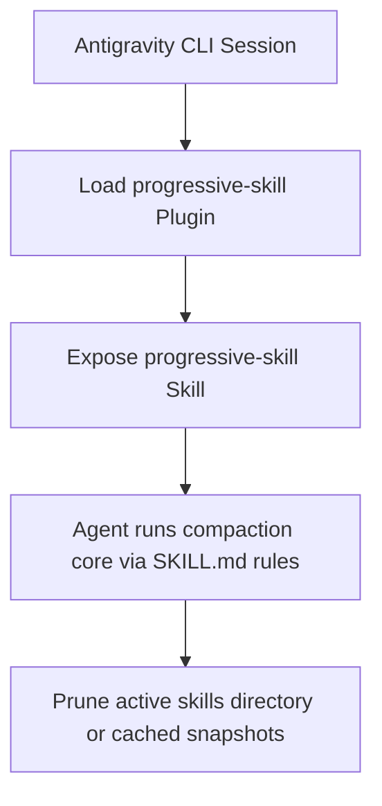

# progressive-skill - Porting Design Specification: Antigravity CLI Integration

This specification details the porting of the `progressive-skill` plugin from Hermes to Google Antigravity CLI (`agy`).

## 1. Architectural Approach

As the Antigravity CLI is a compiled Mach-O binary, dynamic runtime monkey-patching of the prompt builder is not feasible. Instead, the porting strategy integrates `progressive-skill` as a developer-driven utility that can be explicitly invoked by agents to manage and prune their own active skill environments.



## 2. File Specifications

### 2.1 `plugin.json`
Exposes the name, version, and metadata of the ported plugin to the Antigravity system.
```json
{
  "name": "progressive-skill"
}
```

### 2.2 `plugin.yaml`
Specifies capability mappings for the Antigravity environment, explicitly registering the `progressive-skill` skill.
```yaml
name: progressive-skill
version: 3.0.0
description: "Smart skill index compaction — irrelevant categories collapse based on active toolset and usage frequency. Works with Antigravity CLI via cli.py and the progressive-skill skill."
author: "LEO"
license: MIT
provides_skills:
  - progressive-skill
```

### 2.3 `skills/progressive-skill/SKILL.md`
We will retain the general-purpose `SKILL.md` instructing agents how to execute `cli.py` to identify categories to demote and budget-cap rendered indices.

## 3. Installation and Configuration

1. **Symlink Integration**:
   Create a symlink from `/Users/chris/Development/progressive-skill` to `~/.gemini/config/plugins/progressive-skill`.
2. **Config Activation**:
   Register and enable the plugin in `~/.gemini/config/config.json`.
3. **Verification**:
   Execute `agy` to ensure the skill is discovered and registered.
